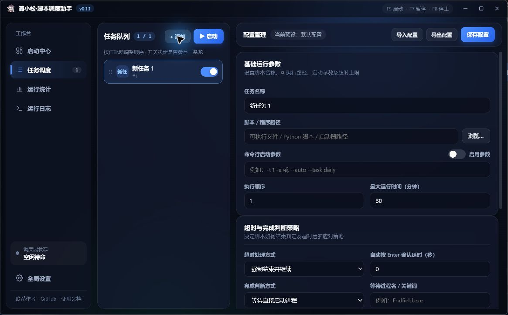

# 简小松（Jiansz）

Windows 上的二游脚本调度助手。把已经能独立运行的工具加入队列，由简小松按顺序启动、判断完成、记录结果和处理超时。游戏内操作由各自的第三方工具执行。


## 快速开始

1. 在 Windows 上打开 `Jiansz.exe`，进入 **任务调度 → + 添加**。
2. 填写任务名称和脚本或程序路径。需要参数时打开 **启用参数**，并选择完成判断方式和最大运行时间。
3. 点击 **保存配置**。先启用一项验证它的启动和完成判断，再添加其他任务。
4. 回到 **启动中心**，点击 **开始执行一条龙**。在启动中心查看本轮进度和脚本简报，在运行日志中排查异常。



## 常用入口

| 入口 | 用途 |
| --- | --- |
| 启动中心 | 执行队列、查看进度与运行报告、打开脚本更新器 |
| 任务调度 | 配置脚本路径、参数、顺序、完成判断、超时与并行组 |
| 运行统计 | 查看各任务的用时、最近结果和可用的脚本运行报告 |
| 运行日志 | 查看任务启动、监控、超时和收尾记录 |
| 全局设置 | 配置启动前检查更新、Windows 自启、完成后关机、QQ 邮件通知 |

更多操作见 [用户指南](USER_GUIDE.md)、[离线使用文档](docs/index.html)和 [FAQ](FAQ.md)。安装版可以从窗口左下角的 **使用文档** 打开离线教程。

## 从源码运行

需要 Windows、Python 和 Microsoft Edge WebView2 Runtime。构建已用 Python 3.12 验证。

```powershell
python -m pip install -r requirements.txt
python main.py
```

运行 `build_exe.bat` 可打包到 `dist/Jiansz/`。程序把运行配置写入 `config.json`，日志和耗时统计分别写入 `logs/` 和 `runtime_stats/`。

## 许可与联系

协议见 [MIT 许可证](LICENSE)。使用第三方工具时请遵守各工具和游戏的服务条款。

[GitHub](https://github.com/Jansongzi) · [Bilibili](https://space.bilibili.com/397555449)
