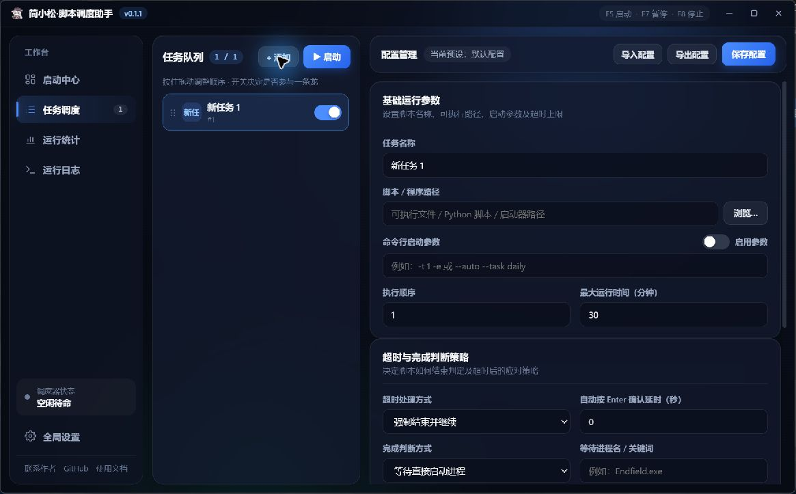
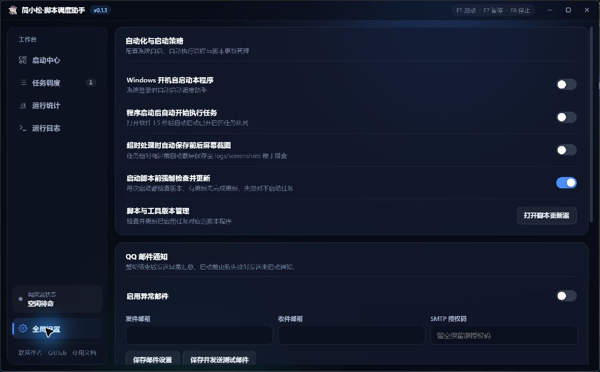

# 简小松使用指南

适用于当前 Windows 桌面程序。安装版的 **使用文档** 按钮可以打开 [离线版](docs/index.html)。

## 添加和验证任务

1. 先单独运行第三方工具，确认它能通过所选的文件和参数开始工作。
2. 打开 **任务调度 → + 添加**。填写任务名称，用 **浏览…** 选中脚本、程序或启动器。
3. 需要命令行参数时打开 **启用参数**，在输入框填写传给程序的参数。
4. 选择 **完成判断方式** 和 **最大运行时间**。某些控制台程序启动后需要按 Enter，可以设置 **自动按 Enter 确认延时**，单位为秒，`0` 表示关闭。
5. 点击 **保存配置**。先只启用这一项，返回 **启动中心** 执行。确认日志中的监控目标和结果符合预期后，再启用其他任务。

### 选择完成判断方式

| 情况 | 建议设置 |
| --- | --- |
| 启动的程序持续运行，工作完成后退出 | 等待直接启动进程 |
| 启动器很快退出，由另一个进程继续工作 | 等待指定进程名，填写实际进程名或关键词 |
| 需要等游戏或模拟器的窗口结束 | 等待窗口标题出现后消失，填写能稳定区分目标窗口的关键词 |
| 启动后需要跟踪多种进程或窗口 | 按面板中的监控方式配置相应关键词，先单项验证 |

多个任务默认按顺序执行。需要并行时，将同组任务在队列中相邻排列，填写相同的并行组，并为该组选择并行策略。核对超时行为再开启无人值守。超时可以强制结束并继续、不结束且跳过，或停止全部任务，具体选项见任务面板。

## 执行和排查

- **启动中心 → 开始执行一条龙** 使用当前启用的任务队列。执行中可以暂停、继续或停止，程序也提供紧急停止。
- **运行日志** 显示启动、目标检测、超时和收尾过程。异常时先核对对应任务的路径、参数和监控目标。
- **运行报告** 查看程序识别到的第三方脚本报告。**运行统计** 显示任务耗时与最近结果。

## 检查脚本更新

从 **启动中心 → 脚本更新** 或 **全局设置 → 打开脚本更新器** 进入。检查版本后可更新已适配的工具。未适配的工具按各自的更新流程处理。

打开 **启动脚本前强制检查并更新** 后，每轮开始前会先检查已适配工具。有可用更新时会先更新。需要检查或更新的环节失败时，查看更新器的错误后再启动。

## 全局设置和邮件

- **Windows 开机自启动本程序** 控制登录后是否打开调度助手。**程序启动后自动开始执行任务** 控制打开后是否自动运行队列。
- **完成后关机** 有倒计时。先验证任务链，再按需要开启。倒计时期间可以在界面取消关机。
- **超时处理时自动保存前后屏幕截图** 保存排查用截图，可在 `logs/screenshots/` 查看。
- 配置 **QQ 邮件通知** 时，填写发件邮箱、收件邮箱和发件邮箱的 SMTP 授权码，用 **保存并发送测试邮件** 验证。邮件用于发送异常汇总和启动前更新失败通知。授权码保存在本机，转交配置前检查邮箱地址和脚本路径。

其他问题见 [FAQ](FAQ.md)。
